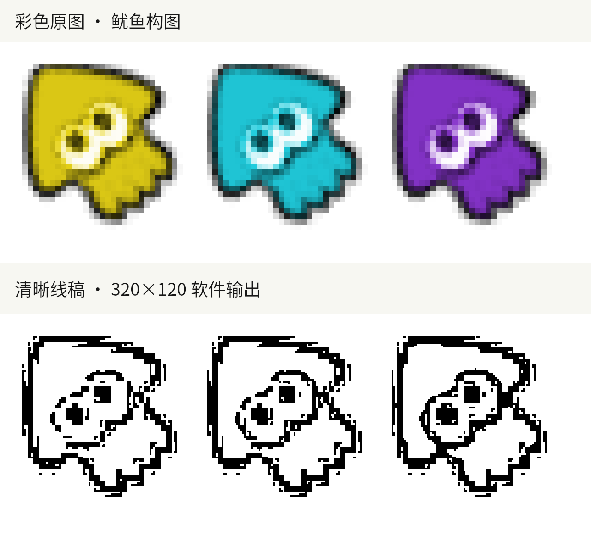
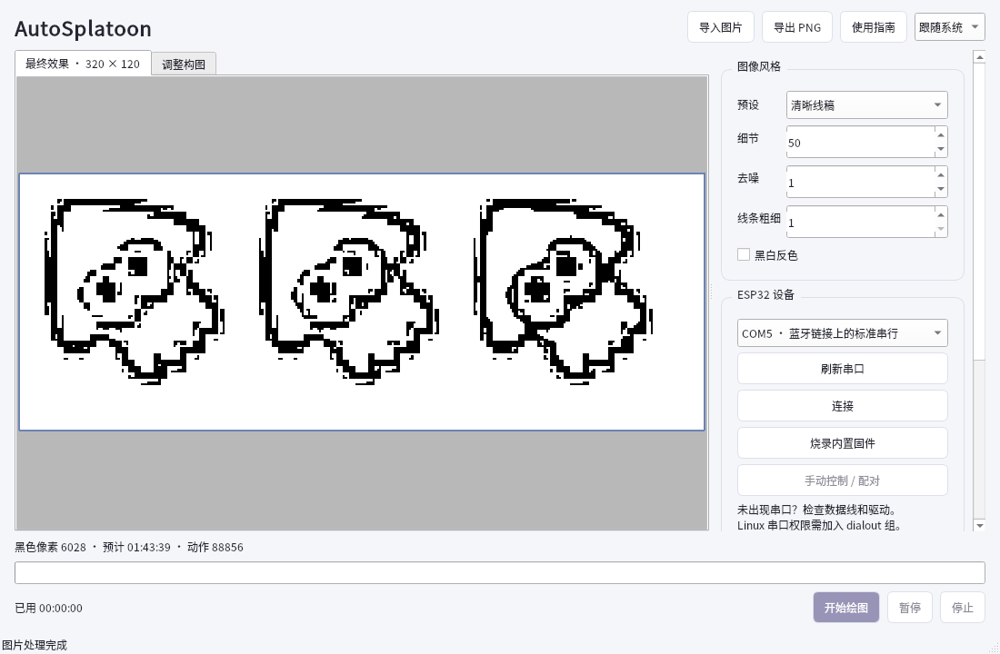
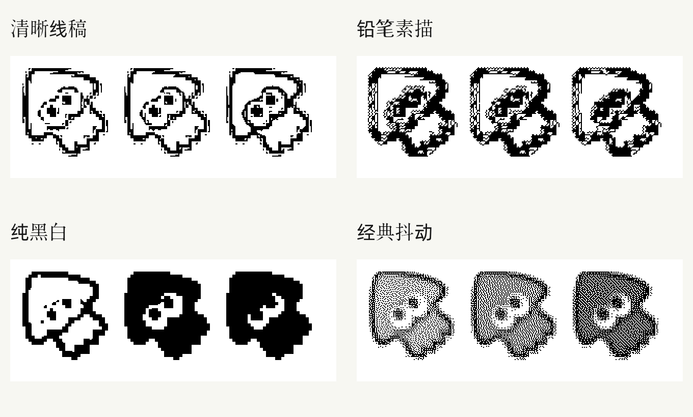
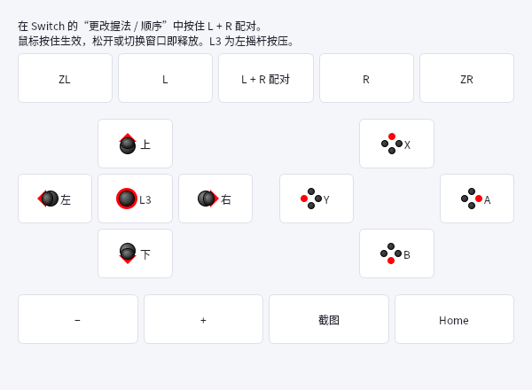

# AutoSplatoon 可以自动绘制广场涂鸦

把喜欢的图片变成 Splatoon 广场上的黑白涂鸦。

AutoSplatoon 先把图片处理成 **320×120 黑白画布**，再通过 ESP32 模拟 Pro Controller，逐步完成绘制。导入后可以拖动、缩放和调整预设，确认结果再开始。图片处理和 PNG 导出可以在电脑上独立使用。

[国内代理下载](#国内下载优先使用代理) · [GitHub 官方发行页](https://github.com/YaleCheng404/AutoSplatoon/releases/latest) · [第一次使用](#首次绘图需要连接和校准) · [硬件与故障排查](docs/hardware.md)

上方为彩色鱿鱼构图，下方为清晰线稿效果。

## 国内下载优先使用代理

国内用户优先使用下表的代理链接，通过 [github.sukii.net](https://github.sukii.net/) 下载本仓库的 Release 文件。下表提供 **v1.0.6** 发行包。

| 系统 | 国内代理下载 · v1.0.6 | 使用条件 |
| --- | --- | --- |
| Windows | [ZIP 下载](https://github.sukii.net/https://github.com/YaleCheng404/AutoSplatoon/releases/download/v1.0.6/AutoSplatoon-1.0.6-Windows-AMD64.zip) | Windows 10/11 x64，完整解压后运行 |
| macOS | [DMG 下载](https://github.sukii.net/https://github.com/YaleCheng404/AutoSplatoon/releases/download/v1.0.6/AutoSplatoon-1.0.6-Darwin-arm64.dmg) | macOS 14.4 或更新版本，Apple Silicon |
| Linux | [AppImage 下载](https://github.sukii.net/https://github.com/YaleCheng404/AutoSplatoon/releases/download/v1.0.6/AutoSplatoon-linux-x64.AppImage) · [目录包下载](https://github.sukii.net/https://github.com/YaleCheng404/AutoSplatoon/releases/download/v1.0.6/AutoSplatoon-linux-x64.tar.gz) | x64；AppImage 和目录包均可选择 |

[下载 SHA-256 校验清单](https://github.sukii.net/https://github.com/YaleCheng404/AutoSplatoon/releases/download/v1.0.6/SHA256SUMS.txt) · [GitHub 官方下载与版本记录](https://github.com/YaleCheng404/AutoSplatoon/releases/latest) · [v1.0.6 更新说明](docs/release-notes/v1.0.6.md)

也可以在代理首页粘贴包含 `releases/download/` 的具体文件地址，或通过 GitHub 官方发行页下载。

发行包包含 Qt 运行库、图片插件、esptool 和 UARTSwitchCon 1.2 固件，**解压后即可运行**。升级时完整解压新包。

## 图片可以调整构图和风格

导入图片后，在“调整构图”中拖动位置、滚轮缩放。透明区域会叠到白底，只有蓝框内的画布参与导出和绘制。

四种预设可以直接切换，下面展示同一张鱿鱼构图的处理效果。

| 预设 | 可以先用在哪些图上 |
| --- | --- |
| 清晰线稿 | 插画和轮廓清楚的图，默认从这里开始 |
| 铅笔素描 | 照片，尝试提取明暗和线条 |
| 纯黑白 | 文字、已有线稿，或想直接控制黑白阈值的图 |
| 经典抖动 | 需要用黑白点阵表现明暗的照片 |

细节、去噪、线条粗细、阈值和反色可以按需调整，界面只显示当前预设用到的参数。预览、导出和绘图计划使用同一份黑白结果，画布保持 320×120 像素。不同素材的表现会有差异，开始绘图前先检查眼睛、细线和小字是否清楚。

## 首次绘图需要连接和校准

自动绘制需要一块带 USB 转串口的**传统 ESP32**、一根支持数据传输的 USB 线，以及电脑和 Switch。内置固件使用经典蓝牙。板卡选择和接线细节见 [硬件说明](docs/hardware.md)。

1. 将开发板连接电脑，刷新并选择串口。
2. 点击“烧录内置固件”。程序确认芯片后写入 UARTSwitchCon 1.2，**这会覆盖开发板原有固件**。烧录完成后可以重复使用。
3. 点击“连接”，等待开发板重启并完成串口连接，再打开“手动控制 / 配对”。在 Switch 的“更改握法 / 顺序”中，按住软件的 **L + R 配对**按钮，等待“Switch 手柄通信正常”。
4. 进入游戏绘图界面，校准光标。软件默认起点是左上角 **(0,0)**，主机上的实际位置要与它一致。先用少量像素检查方向和位置。
5. 导入图片、调整构图和预设，检查黑白结果后开始绘图。过程中可以暂停、继续或停止，结束可自动保存。默认按下和释放各 70 ms，绘图期间保持主机光标和页面稳定。

再次无法配对时，点击“断开连接”再“连接”，等待开发板重启后重新配对，随后校准游戏光标。每次连接都会重启开发板，无需重新烧录固件。

我使用源地 YD-ESP32 开发板和 Switch 2 完成了绘图，设备与连接恢复实测范围见 [验证说明](docs/validation.md)。

## 手动控制可以配对和校准光标

左侧方向键用于校准光标，右侧 ABXY 按 Switch 手柄位置排列。顶部提供 ZL、L、L + R 配对、R、ZR，中央 L3 为左摇杆按压，底部为 −、+、截图和 Home。

鼠标按住按钮生效，松开释放；切换窗口或关闭弹窗也会释放输入。串口断开时弹窗关闭。重新校准时，先停止绘图再打开手动面板。

## 串口连接需要数据线和对应驱动

找不到串口时，先确认数据线和 USB 转串口芯片。Windows 在设备管理器查看，macOS 在系统信息查看，再按板卡选择 [Silicon Labs CP210x](https://www.silabs.com/developer-tools/usb-to-uart-bridge-vcp-drivers) 或 [WCH CH34x](https://www.wch.cn/downloads/CH341SER_EXE.html) 驱动。

Linux 先检查 `/dev/ttyUSB*` 或 `/dev/ttyACM*` 的所属组。Debian/Ubuntu 常见做法是运行 `sudo usermod -aG dialout "$USER"`，然后注销并重新登录。AppImage 无 FUSE 时可以运行 `APPIMAGE_EXTRACT_AND_RUN=1 ./AutoSplatoon-*.AppImage`，或使用目录包中的 AppRun。

固件来源、适用芯片和校验值见 [内置固件说明](firmware/README.md)。找不到串口、烧录失败或再次无法配对时，可以按 [故障排查](docs/hardware.md#连接问题可以逐项排查) 逐项检查。

## 问题反馈和开发说明集中在仓库

遇到问题可以 [提交 Issue](https://github.com/YaleCheng404/AutoSplatoon/issues/new/choose)，选择“问题反馈”后按表单填写版本、系统、现象和复现步骤。设备相关问题可补充板卡型号、Switch 系统和游戏版本，以及错误日志；改进想法可以选择“功能建议”。

项目使用 C++17、Qt Widgets、OpenCV 和 CMake。依赖版本固定在 `dependencies.lock.json`，构建用 Python 工具固定在 `tools/requirements-build.txt`。发行包已包含运行所需组件。

[构建与发布](docs/building.md) · [验证方法](docs/validation.md) · [构建状态](https://github.com/YaleCheng404/AutoSplatoon/actions/workflows/build.yml) · [第三方来源与许可证](licenses/THIRD_PARTY.md)

本项目在 [jiangotto/AutoSplatoon](https://github.com/jiangotto/AutoSplatoon) 和相关上游工作基础上继续维护，感谢原作者及贡献者。代码采用 GPL-3.0，见 [LICENSE](LICENSE)。固件、字体和示例图片按各自的来源声明使用，Splatoon 相关角色归 Nintendo 所有。
