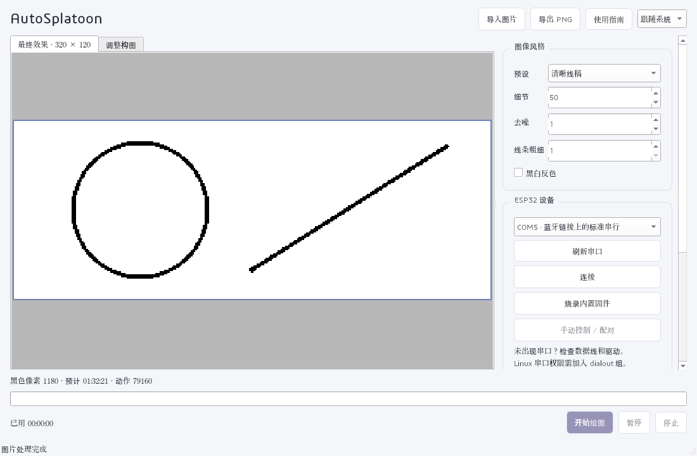
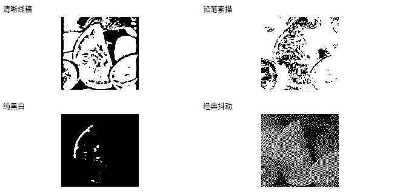

# AutoSplatoon

将图片转换成 Splatoon 的 **320×120 黑白画布**，通过 ESP32 模拟 Pro Controller 自动绘制。使用 Qt 6 界面和 OpenCV 图像处理，提供自包含发行包。

## 下载与首次使用

[下载最新 Release](https://github.com/YaleCheng404/AutoSplatoon/releases/latest) · [构建状态](https://github.com/YaleCheng404/AutoSplatoon/actions/workflows/build.yml) · [1.0.5 更新说明](docs/release-notes/v1.0.5.md)

发行目标：Windows 10/11 x64 ZIP、macOS 14.4+ Apple Silicon DMG、Linux x64 AppImage/目录压缩包。不提供 Intel macOS。包内包含 Qt 运行库、图片格式插件、esptool 与 UARTSwitchCon 1.2 固件；无需安装 Python 或开发环境。

1. 用可传输数据的 USB 线连接传统 ESP32，选择串口。
2. 点击“烧录内置固件”。程序先确认芯片，再写入内置 PRO-UART0.bin（地址 0x0）；烧录会覆盖已有固件。失败时检查 USB 线并按住 BOOT 重试。
3. 点击“连接”，进入“手动控制 / 配对”，在 Switch“更改握法 / 顺序”中按 L + R 配对；显示“Switch 手柄通信正常”后可自动绘图。参考 [上游硬件与配对说明](https://github.com/nullstalgia/UARTSwitchCon)。
4. 打开游戏绘图画布，用手动控制校准到指定起点。坐标从 0 开始；默认左上角 (0,0)。
5. 导入图片，在“调整构图”标签拖动、滚轮缩放，选择预设，检查结果后开始绘图。按下/释放默认各 70 ms；可暂停、继续或停止，结束可自动保存。

没有开发板也能处理图片和导出 PNG。预览、导出和动作计划使用同一黑白结果，缩放窗口与显示器 DPI 不改变画布像素。界面优先使用系统字体，缺少中文字形时使用内置 Noto Sans CJK 回退；使用自适应布局与滚动参数栏，提供浅色、深色及系统主题。

## 手动控制 / 配对

顶部为 ZL、L、L + R 配对、R、ZR；左侧十字方向键用于移动光标，中央 L3 为左摇杆按压；右侧 ABXY 按 Switch 手柄位置排列，底部为 −、+、截图和 Home。

鼠标按住按钮生效，松开释放；切换窗口、关闭弹窗会释放当前输入，重新打开后需再次按下。串口断开时弹窗关闭。绘图运行和暂停期间均不可进入手动控制；校准光标前请先停止绘图。小窗口可滚动查看全部按钮。

## 图片处理

| 预设 | 用途 |
|---|---|
| 清晰线稿（默认） | 保边去噪、自适应阈值、小区域清理，保留连续轮廓 |
| 铅笔素描 | OpenCV pencilSketch 后转换为黑白，适合照片轮廓 |
| 纯黑白 | 可调阈值，适合文字和已有线稿 |
| 经典抖动 | Qt 黑白误差扩散，表达照片明暗 |

可调整细节、去噪、线条粗细、阈值及反色；只显示当前预设使用的参数。默认等比居中，透明区域叠到白底。处理在后台执行，快速调参只展示最新结果。“手绘感”指最终图像效果，绘制动作采用可验证的蛇形扫描。

对比素材来自 [OpenCV 4.14.0 fruits.jpg](https://github.com/opencv/opencv/blob/4.14.0/samples/data/fruits.jpg)，方形照片等比居中到 320×120 画布，左右留白；图中输出未做额外美化。

## 串口与硬件

协议为 19200 波特率、CRC-8 和上游握手。固件 SHA-256：`d8b2e49b221bb363ef1d72908582ce48690e3b9538500aeb77f470b433b66039`，来源和许可证见 [firmware/README.md](firmware/README.md)。支持范围限传统 ESP32；其他 ESP32 系列和 Switch 2 未验证。

Windows/macOS 找不到串口时，先在设备管理器/系统信息确认 USB 转串口芯片，按板卡型号安装 [Silicon Labs CP210x 驱动](https://www.silabs.com/developer-tools/usb-to-uart-bridge-vcp-drivers) 或 [WCH CH34x 驱动](https://www.wch.cn/downloads/CH341SER_EXE.html)，不要盲目安装全部驱动。Linux 检查 `/dev/ttyUSB*`、`/dev/ttyACM*` 和 `ls -l` 的所属组；Debian/Ubuntu 通常执行 `sudo usermod -aG dialout "$USER"` 后注销并重新登录。不建议以 root 运行应用。AppImage 无 FUSE 时可用 `APPIMAGE_EXTRACT_AND_RUN=1 ./AutoSplatoon-*.AppImage`，或使用目录包中的 AppRun。

## 开发与验证

[硬件与故障排查](docs/hardware.md) · [构建与发布](docs/building.md) · [验证方法与范围](docs/validation.md) · [第三方来源与许可证](licenses/THIRD_PARTY.md)。

项目使用 C++17、Qt Widgets、OpenCV、CMake/CTest/CPack。SDK 与下载资产固定在 `dependencies.lock.json`，Python 构建工具固定在 `tools/requirements-build.txt`。运行应用无需 Python 或开发环境。

项目采用 GPL-3.0，见 [LICENSE](LICENSE)。固件、字体及依赖的来源和声明随安装包提供。构建、模拟与部署测试的范围见验证文档；真实设备和物理显示器的覆盖取决于具体测试环境。
