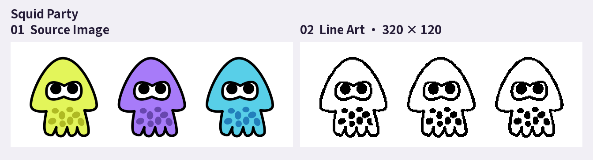
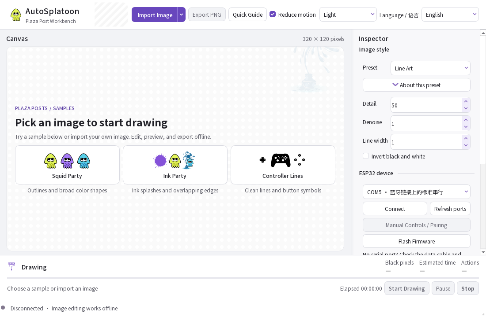
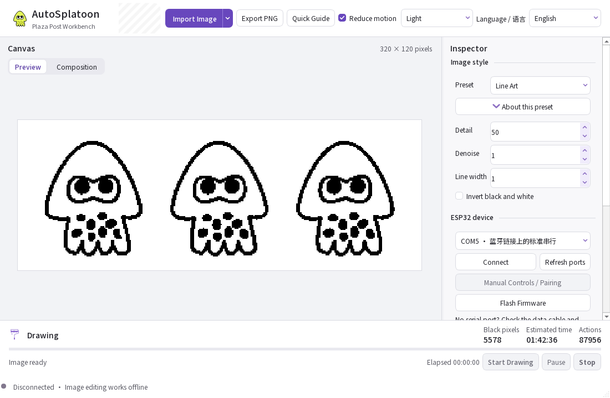
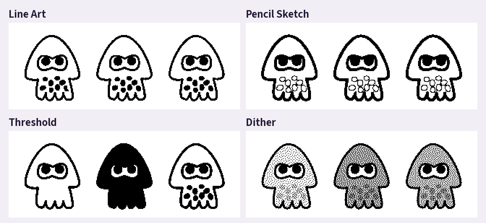
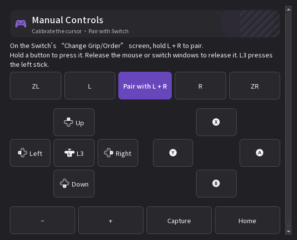

# AutoSplatoon

English | [简体中文](README.zh-CN.md)

AutoSplatoon turns images into **320 × 120 black-and-white Splatoon plaza posts**. Compose and preview your image on Windows, macOS, or Linux, then use an ESP32 that emulates a Pro Controller to draw it on Nintendo Switch. Image editing and PNG export work offline without any hardware.

[Download](#download) · [First drawing](#first-drawing) · [Hardware and troubleshooting](docs/hardware.md) · [Build from source](docs/building.md)

## Download

Get the latest packages from [GitHub Releases](https://github.com/YaleCheng404/AutoSplatoon/releases/latest). The links below are for **v1.1.0**.

| Platform | GitHub download | Requirements |
| --- | --- | --- |
| Windows | [ZIP](https://github.com/YaleCheng404/AutoSplatoon/releases/download/v1.1.0/AutoSplatoon-1.1.0-Windows-AMD64.zip) | Windows 10 or 11, x64. Extract the full archive. |
| macOS | [DMG](https://github.com/YaleCheng404/AutoSplatoon/releases/download/v1.1.0/AutoSplatoon-1.1.0-Darwin-arm64.dmg) | macOS 14.4 or later, Apple Silicon |
| Linux | [AppImage](https://github.com/YaleCheng404/AutoSplatoon/releases/download/v1.1.0/AutoSplatoon-linux-x64.AppImage) · [Directory archive](https://github.com/YaleCheng404/AutoSplatoon/releases/download/v1.1.0/AutoSplatoon-linux-x64.tar.gz) | x64. Run the AppImage or extract the archive and run `AppRun`. |

[SHA-256 checksums](https://github.com/YaleCheng404/AutoSplatoon/releases/download/v1.1.0/SHA256SUMS.txt) · [Release notes](docs/release-notes/v1.1.0.md) · [Mainland China download mirror](https://github.sukii.net/)

The packages bundle the Qt runtime, image plugins, esptool, and UARTSwitchCon 1.2 firmware. When upgrading, extract the complete new package. On Linux without FUSE, run `APPIMAGE_EXTRACT_AND_RUN=1 ./AutoSplatoon-*.AppImage` or use the directory archive.

## Prepare an image

Start with Squid Party, Ink Party, or Controller Lines from the sample gallery. After importing an image, use the dropdown on **Import Image** to load a different sample.

In **Composition**, drag the image to position it and scroll to zoom. Transparent areas are composited onto white. The bordered canvas is the area used for export and drawing. The inspector contains the image preset, ESP32 connection, and drawing controls. Choose a light, dark, or system theme, and use **Reduce motion** to disable decorative animations.

In a build from the current source, use **Language / 语言** in the top bar to select **System default**, **简体中文**, or **English**. The app saves the preference and applies it on your next launch. With **System default**, a Chinese system uses Simplified Chinese and other systems use English.

| Preset | Try it with |
| --- | --- |
| Line Art | Illustrations with distinct outlines. This is the default. |
| Pencil Sketch | Photos or artwork where shading and fine strokes matter |
| Threshold | Text, logos, and existing line art that needs a direct black-and-white cutoff |
| Dither | Photos or gradients that benefit from dot patterns |

Adjust detail, denoising, line width, threshold, or inversion as needed. The inspector shows the controls used by the active preset. The preview, PNG export, and drawing plan use the same 320 × 120 image. Check small text, eyes, and thin strokes before drawing.

[View the three source images, all preset outputs, and art credits](docs/images/README.md)

## First drawing

You need an **original ESP32** with a USB-to-serial interface, a USB data cable, and a Nintendo Switch. The bundled firmware uses Bluetooth Classic. See [supported boards and wiring](docs/hardware.md).

1. Connect the board, refresh the port list, and select the correct serial port.
2. Click **Flash Firmware**. AutoSplatoon checks the chip and writes UARTSwitchCon 1.2. **Flashing overwrites the board's existing firmware.** You can reuse the board without flashing it again.
3. Click **Connect** and wait for the board to reboot and the serial connection to open. Open **Manual Controls / Pairing** and hold **Pair with L + R** on the Switch's **Change Grip/Order** screen. Wait for the app to report that the controller is active.
4. Open the game's drawing screen, choose the smallest brush, and calibrate the cursor. The default start is the top-left corner at row 0, column 0. Draw a few pixels to check direction and position.
5. Import an image, adjust it, and check the black-and-white preview before you start. You can pause, resume, or stop while drawing. The app can press **−** to save at the end. Each press and release lasts 70 ms by default. Keep the console on the drawing screen with the cursor undisturbed.

If pairing fails again, see [connection troubleshooting](docs/hardware.md#troubleshooting).

## Manual controls

Use the directional buttons to calibrate the cursor and **Pair with L + R** to pair the controller.

Hold a button with the mouse to press it. Releasing the mouse, switching windows, or closing the dialog releases the input. The dialog closes if the serial connection drops. Stop drawing before opening Manual Controls to recalibrate.

[Connection and flashing troubleshooting](docs/hardware.md#troubleshooting)

## Support and development

[Open an issue](https://github.com/YaleCheng404/AutoSplatoon/issues/new/choose) to report a problem or suggest a feature. For a bug, include the application version, operating system, steps to reproduce, and any relevant logs. For a device issue, include your board, console, system, and game versions.

[Build and release](docs/building.md) · [Validation](docs/validation.md) · [Build status](https://github.com/YaleCheng404/AutoSplatoon/actions/workflows/build.yml) · [Third-party sources and licenses](licenses/THIRD_PARTY.md)

AutoSplatoon continues work from [jiangotto/AutoSplatoon](https://github.com/jiangotto/AutoSplatoon) and related projects. The code is available under [GPL-3.0](LICENSE). The firmware, font, and sample artwork have their own notices. Splatoon characters belong to Nintendo.
